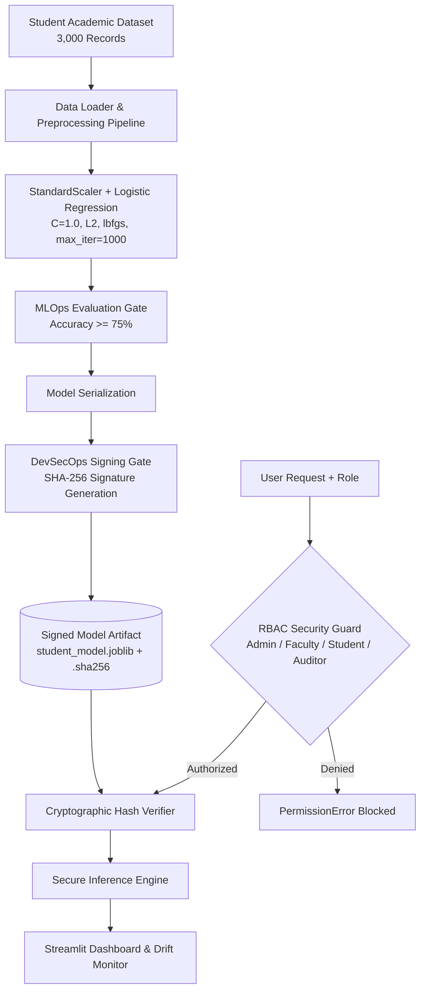

# Student Academic Performance Analytics
### Internal Project 2 | Subject: DevSecMLOps

---

## 📋 Project Submission Details (Reference Table Format)

| Attribute | Details |
|---|---|
| **Internal Project** | Internal Project 2 |
| **Application Area / Domain** | Education / Student Academic Performance |
| **Project Title** | Student Academic Performance Analytics |
| **Dataset Name** | `student_academic_performance_dataset` |
| **Dataset Features** | `Student_ID, Gender, Attendance_Percentage, Study_Hours_per_Week, LMS_Hours, Internal_Marks, Final_Grade` |
| **Model Parameters** | `Logistic Regression + StandardScaler; L2, C=1.0, lbfgs, max_iter=1000, random_state=42.` |
| **MLOps Evaluation Metrics** | Accuracy: 91.33%, Precision: 92.33%, Recall: 94.26%, F1-Score: 93.28%, ROC-AUC: 0.9740 |
| **DevSecOps Security Controls** | Role-Based Access Control (RBAC), Bandit SAST scanner, SHA-256 model signing, Continuous Cohort Data Drift Monitoring |
| **GitHub Repository** | [https://github.com/jairajcj/student-academic-performance-devsecmlops](https://github.com/jairajcj/student-academic-performance-devsecmlops) |

---

## 🏛️ System Architecture



---

## 🚀 How to Run the Project

### 1. Setup Environment
```bash
cd Internal_Project_2_Student_Performance
pip install -r requirements.txt
```

### 2. (Optional) Re-generate Dataset
```bash
python data/generate_dataset.py
```

### 3. Train the Model & Generate Cryptographic Signature
```bash
python src/train.py
```
*Outputs `models/student_model.joblib`, `models/student_model.joblib.sha256`, and `models/metrics.json`.*

### 4. Run DevSecOps SAST Security Scan
```bash
python -m bandit -r src/ -f screen
```

### 5. Run Unit & Security Integrity Tests
```bash
python -m pytest tests/ -v
```
*Runs 8 tests verifying data loading, inference accuracy, RBAC permissions, and model tampering attack detection.*

### 6. Launch the Interactive Web Dashboard
```bash
streamlit run app.py --server.port 8502
```
Open `http://localhost:8502` to assess student risk profiles, test RBAC role permissions live, and monitor cohort data drift.

### 7. Run with Docker
```bash
docker build -t student-analytics:latest .
docker run -p 8502:8502 student-analytics:latest
```

---

## 🎯 External Viva Examination Q&A Guide

### Q1: Why use a StandardScaler inside a Pipeline with Logistic Regression?
> **Answer:** Logistic Regression with L2 regularization ($C=1.0$) is sensitive to feature scaling. If features like `LMS_Hours` (range 10–150) and `Study_Hours_per_Week` (range 1–40) are on different scales, the penalty disproportionately affects features with larger magnitudes. `StandardScaler` centers the mean to 0 and variance to 1, ensuring uniform gradient convergence and fair regularization.

### Q2: How does Role-Based Access Control (RBAC) enhance security in this ML system?
> **Answer:** Medical and educational student records are governed by privacy regulations (such as FERPA and GDPR). RBAC ensures principle of least privilege:
> - **Students** can only view their own assessment; they cannot retrain models or access batch records.
> - **Faculty** can perform student evaluations and view class distributions.
> - **Auditors** can review security hashes and drift reports without modifying student records.
> - **Admins** have model deployment and retraining privileges.

### Q3: What is Data Drift and how is it detected in this project?
> **Answer:** Data drift (covariate shift) occurs when the statistical distribution of input features in production shifts away from the training distribution (e.g., if a new semester has drastically lower attendance due to curriculum changes). In `drift_detector.py`, we monitor the normalized mean shift:
> $$Z = \frac{|\mu_{\text{current}} - \mu_{\text{baseline}}|}{\sigma_{\text{baseline}}}$$
> When $Z \ge 0.30$, an automated MLOps alert is triggered recommending model retraining.

### Q4: How is model tampering prevented?
> **Answer:** We generate an immutable SHA-256 cryptographic digest of the trained pipeline file `student_model.joblib`. During runtime, `security_scanner.py` verifies this hash before reading the model into memory. Any external tampering or byte modification triggers a security halt.
